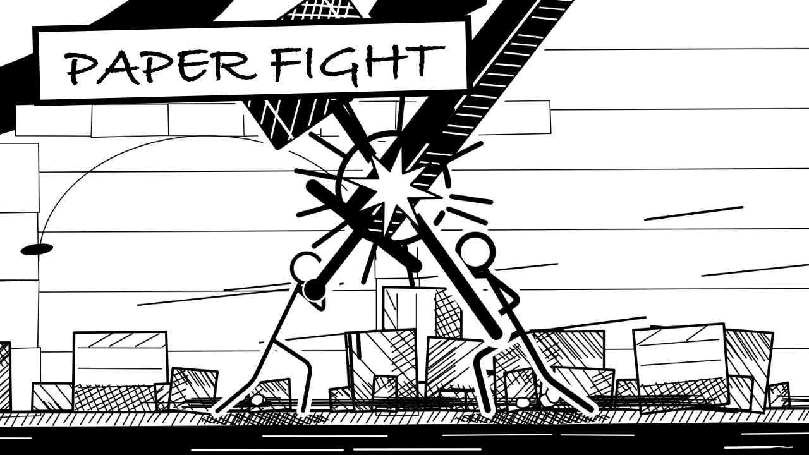
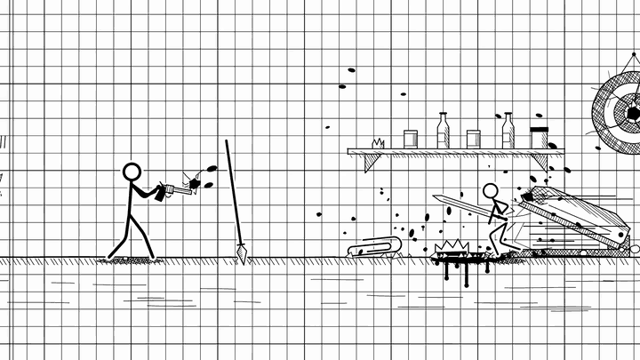
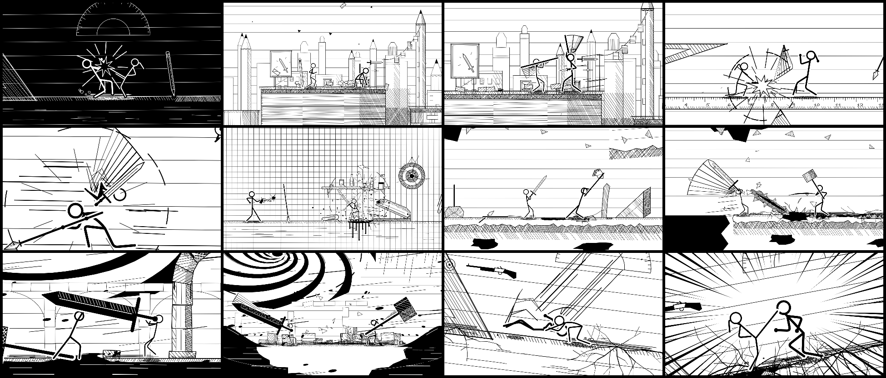

<div align="center">

# stick-figure-film

**A Claude skill for making animated short films where every frame is drawn in code.**

Stick-figure characters · ink-and-hatching look · choreographed action · cinematic camera ·
synced sound and music · rendered to MP4 · no video-generation model involved.

[](LICENSE)
[](https://platform.claude.com/docs/en/agents-and-tools/agent-skills/overview)
[](https://nodejs.org)
[](https://ffmpeg.org)



</div>

---

## What it is

`stick-figure-film` turns Claude into a small animation studio. Describe a film, for example *"a 20-second
rooftop sword fight, black ink on notebook paper, with sound"*, and Claude writes it the way a
studio would make it: characters on a rig, pose keys, a keyframed camera, effects and a sound cue
sheet. A script then draws every frame on a canvas and encodes the result with ffmpeg.

Because the film is code, everything is editable and deterministic: change a pose, a camera move
or a timing and re-render. Nothing is generated by a video model.

The skill was extracted from the production of **PAPER FIGHT**, a three-minute, seven-scene
stick-figure action film. It bundles the engine that film was made with and the working method
that got it there, including the mistakes, written down so they are not repeated.

<div align="center">

<br>
<sub>A few seconds of PAPER FIGHT (silent preview; the film has a full soundtrack).</sub>
</div>

## Features

- **A complete film pipeline.** Project template, story bible, one file per scene, review on
  contact sheets, sound mix, MP4 render, end credits and social cuts.
- **A character rig that moves well.** Two-bone IK limbs, a flexible spine, follow-through, smear
  frames, ballistic jumps on true parabolas, hands and feet pinned to the world for grabs and
  wall-runs.
- **Weapons and props.** Thirteen weapon types, from a pencil staff to an ink-forged greatsword,
  a revolver and a rifle, that can be held, thrown, planted, morphed and broken. Shots come with muzzle
  flash, tracers, casings, ricochets and persistent bullet holes.
- **A cinematic camera.** Keyframed pan, zoom and roll; fighter tracking; shake; impact frames;
  slow motion; bullet-time close-ups.
- **A notebook world kit.** Ruled pages, hatched floors, breakable brick walls, debris, cracks,
  tears, parallax layers, page-turn transitions.
- **Sound with no assets required.** A built-in synthesizer renders effects and a scene-by-scene
  score from the cue sheet, loudness-normalised and frame-accurate. Optionally, generate the
  effects and score with [ElevenLabs](https://elevenlabs.io) using your own API key.
- **Review tools for an AI that cannot watch video.** Contact sheets, a joint/weapon probe, a
  blade-crossing finder and an animation lint (teleporting joints, limbs through the floor,
  characters out of frame).
- **Honest delivery.** The skill makes Claude say what it checked and how (on still frames and
  by measurement) and that the film was never watched in motion or heard.

<div align="center">

<br>
<sub>Frames from PAPER FIGHT: bare hands, a city of pencils, a geometry zone, a graph-paper gunfight, a torn-paper battlefield, an ink storm.</sub>
</div>

## Install

```bash
npx skills add lauroguedes/stick-figure-film-skill
```

This uses the [`skills`](https://github.com/vercel-labs/skills) CLI (Node.js 22.20 or later). It
installs the skill into the current project for the coding agents it detects; add `-g` to make it
available in every project, or `-a claude-code` to choose the agent:

```bash
npx skills add lauroguedes/stick-figure-film-skill -g -a claude-code
```

The skill was written and tested with Claude Code. Other agents the CLI supports can load it,
but its review workflow assumes an agent that can read images and run shell commands.

<details>
<summary>Manual install</summary>

Copy the `skills/stick-figure-film/` folder into a skills directory Claude reads:

```bash
git clone https://github.com/lauroguedes/stick-figure-film-skill.git
```

```bash
cp -R stick-figure-film-skill/skills/stick-figure-film ~/.claude/skills/
```

For the Claude apps, zip the `skills/stick-figure-film/` folder and upload it as a custom skill.

</details>

## Usage

Ask for a film in plain words. The skill triggers on requests for animated shorts, fight scenes,
stick-figure or doodle animation, or code-drawn video:

> Make a 20-second stick figure sword fight on a rooftop, black ink on notebook paper, one quick
> fighter and one heavy one, two real clashes, and one gets knocked off the roof. With sound.

> I teach primary school. Make a 12-second animation where a stick figure throws a paper plane,
> chases it, trips over a pencil and catches it with a jump. Friendly, with some sound.

> Add a new scene to my film where they fight with spears on a floating ruler.

> Make a 30-second teaser, three vertical clips and a thumbnail from my film.

For short films Claude builds the whole thing and tells you every choice it made. For long films
it delivers a 15-second prototype first and waits for your approval, then writes a story bible
and builds the scenes, in parallel with one agent per scene when subagents are available.

## How it works

```
 brief ─▶ prototype ─▶ story bible ─▶ scenes (one file each) ─▶ review on contact sheets
                                            │                              │
                                            ▼                              ▼
                                   sound cue sheet ─▶ soundtrack ─▶ render MP4 ─▶ credits & social cuts
```

A scene is one JavaScript file with its own clock. It declares pose keys for the characters,
weapon tracks, camera keys, contacts and drawing hooks for its set:

```js
const S = createScene({ id: 'rooftop', title: 'Rooftop', duration: 10, score: 'duel' });
S.fighters({ A: [ /* pose keys */ ], B: [ /* pose keys */ ] });
S.weapon('sword', [ /* held / thrown / planted keys */ ]);
S.camera([ /* pan, zoom, roll, tracking */ ]);
S.hit({ t: 3.4, x: 1180, h: 160, sound: 'clang', weight: 0.9, impact: true });
S.env({ stage(ctx, t, E) { /* draw the rooftop */ } });
export default S.build();
```

`S.hit` places the burst, the sound and the camera shake on the same frame, so picture and sound
cannot drift. Every frame is a pure function of time, so any frame can be rendered on its own.

## What's in this repository

```
skills/stick-figure-film/     the skill
├── SKILL.md                  workflow and the craft rules learned the hard way
├── references/
│   ├── engine.md             scene authoring API: poses, weapons, camera, effects, set kit
│   ├── production.md         story bible, scene and polish briefs for subagents, checklists
│   └── sound.md              cue sheet, synthesizer, score styles, optional ElevenLabs
└── assets/template/          the project scaffold Claude copies for each new film
    ├── src/engine/           rig, weapons, camera, effects, ink, set kit, scene runtime
    ├── src/scenes/           a minimal example, the full 15-second fight example, a weapon gallery
    └── tools/                render, contact sheets, probe, lint, sound, social cuts, preview
examples/paper-fight/         the scene files, credits and story bible of the original film
evals/                        test prompts and graders for the skill
docs/                         images for this README
```

## Requirements

| | |
|---|---|
| **Node.js** | 20 or newer. The only npm dependency is [`@napi-rs/canvas`](https://github.com/Brooooooklyn/canvas). |
| **ffmpeg** | On the `PATH`, for encoding and audio checks. |
| **Fonts** | The handwriting fonts `Bradley Hand` / `Noteworthy` (macOS) are used for doodles and credits; on other systems set a font you have in `kit.js` and `credits.js`. |
| **ElevenLabs** (optional) | Your own API key in `ELEVEN_LABS_API_KEY`, only if you want generated effects and score. |

## Try the engine without Claude

```bash
cp -R skills/stick-figure-film/assets/template my-film && cd my-film && npm install
```

```bash
npm run build      # soundtrack + film → out/film.mp4 (the minimal example scene)
```

```bash
npm run preview    # scrubbable player at http://localhost:4173/preview.html
```

```bash
node tools/sheet.mjs --scene ref --from 3 --to 6 --n 12 --out out/sheet.png   # contact sheet of the fight example
```

## Sound and generated audio

Sound works out of the box with the built-in synthesizer: no network, no assets, no cost. Each
scene picks a score style: `duel`, `chase`, `clockwork`, `heavy`, `climax`, `aftermath`,
`playful` or `none`.

ElevenLabs generation is optional. It spends **your** credits, so the skill reads the current
API docs, estimates the cost, and asks you for an explicit credit cap before generating anything.
Generated files are cached and never regenerated without `--force`. Check your ElevenLabs plan's
licence terms before publishing generated audio.

## Limitations

- **Claude cannot watch or hear the film.** It reviews still frames and measurements. Timing in
  motion, music and the mix are yours to judge, and the skill says so every time.
- **It is 2D.** Simulated 3D camera moves around flat figures did not work and are deliberately
  not offered; dramatic moments use moving close-ups instead.
- **The engine's vocabulary is a fighter's** (`S.fighters`, `S.hit`, weapons). Non-fight stories
  work (chases, props, falls, comic beats), but some props are drawn by hand in scene hooks.
- **Long films are long jobs.** A three-minute film is many agent-hours of work and can run into
  usage limits; scene files are saved as they go so interrupted work can resume.

## Evaluations

`evals/` holds two test cases, a rooftop sword duel and a classroom paper-plane chase, with
graders, in the format read by `claude plugin eval`. In a first trial, runs with the skill passed
12 of 12 checks against 10 of 12 without it; the difference was honest reporting of what was and
was not verified. The trial's findings shaped the current version.

## Credits

- **PAPER FIGHT**: directed by Lauro Guedes, animated by Claude.
- Sound effects and score of the original film generated with ElevenLabs; the skill's default
  sound is synthesized.

## License

[MIT](LICENSE) © 2026 Lauro Guedes
